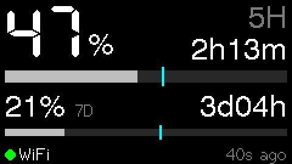
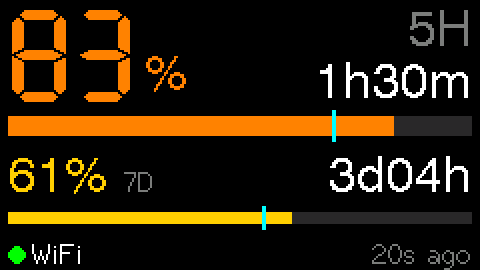
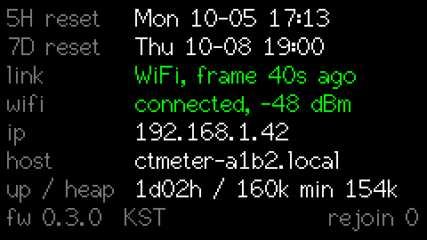

# claude-token-meter

**Claude 구독의 사용 한도**를 얼마나 썼는지 보여 주는 작은 책상용 디스플레이입니다. **5시간** 롤링 창과 **주간(7일)** 창의 사용량을 브라우저를 열지 않고 한눈에 볼 수 있습니다.

[English README](README.md)

<p>
  
  
</p>

[LilyGO T-Display](https://www.lilygo.cc/products/lilygo-t-display-esp32-1-14-inch)(클래식 ESP32, 240×135 IPS)에서 동작합니다. 수치는 **Mac에서 쓰는 Claude Code**에서 가져옵니다. **Anthropic으로 가는 추가 요청은 0건**이고, Claude 자격증명은 전혀 건드리지 않습니다.

## 사용량을 가져오는 방식

Claude Code는 어시스턴트 메시지마다 [statusLine](https://code.claude.com/docs/en/statusline) 명령에 JSON을 넘깁니다. Pro와 Max 구독자라면 이 JSON에 `rate_limits.five_hour`와 `rate_limits.seven_day`가 들어 있고, 각각 `used_percentage`와 `resets_at` 값을 가집니다. 이 프로젝트는 작은 statusLine 스크립트를 등록해 이 값을 로컬에 저장합니다. 그러면 Mac의 백그라운드 브리지가 USB나 WiFi로 디바이스에 보냅니다.

```
Claude Code 세션들 ──stdin JSON──▶ host/ctm/statusline.py   (~20ms, 네트워크 없음)
                                        │ 세션별 파일
                                        ▼
                        ~/.claude-token-meter/sessions/*.json
                                        │
                                        ▼
                   브리지 (LaunchAgent com.ctm.bridge, Python)
                     ├─ 병합: 창별로 리셋 시각이 늦은 쪽 우선, 같은 창이면 최댓값
                     ├─ 송신: 변화 시 + 120초 하트비트, 웨이크 시 즉시
                     └─ 보드가 USB로 꽂혀 있으면 USB 시리얼, 아니면 WiFi
                        (mDNS + HMAC-SHA256 서명 HTTP POST)
                                        ▼
                     T-Display 펌웨어: 검증 → 상태 → 렌더
```

이 설계에서 나오는 특징은 다음과 같습니다.

- **수치는 Claude Code를 쓰는 동안에만 갱신됩니다.** claude.ai 웹이나 데스크톱·모바일 앱에서 쓴 양도 같은 한도에 포함됩니다. 그 양은 다음 Claude Code 메시지 때 반영됩니다. 데이터가 몇 분 전 것인지는 하단에 항상 표시됩니다.
- **세션이 여러 개여도 문제없습니다.** 세션마다 자기 마지막 응답의 값을 들고 있어서 값이 서로 다릅니다. 브리지는 같은 창 안에서 사용량이 줄지 않는다는 성질을 이용해 최댓값으로 병합합니다.
- **Anthropic 로그인, API 키, 폴링이 모두 없습니다.** Mac은 LAN이나 USB로 디바이스와만 통신합니다.

## 화면 읽는 법

| 요소 | 의미 |
|---|---|
| 큰 숫자 | 5시간 창 사용률(%)과 리셋까지 남은 시간 |
| 작은 숫자 | 7일 창 사용률(%)과 리셋까지 남은 시간 |
| 막대 | 각 창의 사용률 |
| 막대 위 청록 눈금 | **페이스**: 창의 시간이 얼마나 지났는지를 나타냅니다. 막대가 눈금을 넘었다면 한도가 차오르는 속도보다 빨리 쓰고 있다는 뜻입니다. |
| 색 | 페이스 이하이면 중립, 페이스를 넘으면 **앰버**, 80% 이상 **주황**, 95% 이상 **빨강** |
| 하단 점 | 초록: 150초 이내에 데이터 수신. 회색: 그보다 오래됨. 빨강과 "host offline": 5분 넘게 수신 없음. "USB"/"WiFi"는 마지막 값이 들어온 경로입니다. |
| `restored` | 전원을 켠 직후 저장해 둔 마지막 값을 보여 줄 때 표시됩니다. Mac이 새 값을 보낼 때까지 유지되고, 시계가 맞춰지기 전에는 시간이 `--`로 나옵니다. |
| `0% · reset` (회색) | 그 창의 리셋 시각이 지났다는 뜻입니다. Claude Code가 새 응답을 받기 전까지는 추정값입니다. |

**버튼:**

- **BTN1**(GPIO35)을 짧게 누르면 상세 뷰가 나옵니다. 리셋 시각(현지 시간), WiFi/IP/RSSI, 가동 시간, 힙, 재접속 횟수를 보여 주고 15초 뒤 메인 화면으로 돌아갑니다.
- **BTN2**(GPIO0)로 백라이트를 100%, 40%, 10% 순으로 바꿉니다.
- 60분 동안 값이 변하지 않으면 백라이트가 자동으로 어두워집니다.



## 준비물

- **macOS.** 브리지가 launchd, Keychain, mDNS를 씁니다. Linux에서 쓰려면 `ctm install`과 키 저장소를 이식해야 합니다.
- **Pro 또는 Max 구독의 Claude Code.** statusLine JSON에 `rate_limits`가 들어가는 최근 버전이어야 합니다. 2.1.289에서는 있었고, 2.1.283과 2.1.284에서는 없었습니다.
- **LilyGO T-Display, 클래식 ESP32**(S3 아님). 파티션 테이블은 **16MB 플래시** 모델 기준입니다(`firmware/partitions_16mb.csv`). 4MB 모델이라면 `platformio.ini`에서 `board_upload.flash_size`와 `board_build.partitions` 두 줄을 지우면 됩니다. 앱 크기는 약 1MB입니다.
- [PlatformIO](https://platformio.org/). 함께 설치되는 Python(`~/.platformio/penv/bin/python3`)에 브리지가 쓰는 `pyserial`이 이미 들어 있습니다.
- statusLine 스크립트용 `/usr/bin/python3`(Xcode Command Line Tools).
- Mac과 보드가 함께 쓰는 2.4GHz WiFi. WiFi는 선택이며, USB만으로도 동작합니다.

## 빠른 시작

호스트 명령은 모두 `host/` 폴더에서 실행합니다. 입력을 줄이려면 별칭을 만들어 두세요.

```sh
cd host
alias ctm='~/.platformio/penv/bin/python3 -m ctm.cli'
```

**1. 보드 선택.** T-Display를 USB로 꽂고 실행합니다.

```sh
ctm select-board
```

USB 시리얼 포트를 시리얼 번호, 칩 종류와 함께 보여 주고, 고른 보드를 `~/.claude-token-meter/config.json`에 저장합니다. 브리지는 USB 시리얼 번호가 일치하는 **그 보드만** 엽니다. 책상 위의 다른 ESP32 보드는 건드리지 않습니다.

**2. 펌웨어 굽기.**

```sh
cd .. && ~/.platformio/penv/bin/pio run -d firmware -e t-display -t upload \
  --upload-port "$(cd host && ~/.platformio/penv/bin/python3 -m ctm.cli port)"
cd host
```

**3. 브리지와 statusLine 설치.**

```sh
ctm install --statusline --dry-run   # 무엇이 바뀌는지 먼저 확인
ctm install --statusline
```

- `~/Library/LaunchAgents/com.ctm.bridge.plist`를 씁니다. 브리지는 로그인할 때 시작되고, 종료되면 다시 뜹니다.
- `~/.claude/settings.json`에 `statusLine`을 등록합니다. 그 전에 시각이 붙은 백업을 남깁니다.
- **이미 쓰는 statusLine이 있으면** 설치를 멈추고 기존 설정을 보여 줍니다. `--force`를 붙이면 교체합니다. 설치 후 터미널 상태줄에 `5h 47% · 7d 21%`가 표시됩니다.

**4. WiFi 페어링(선택).** **일반 터미널**(Terminal이나 iTerm)에서 실행하세요. 비밀번호를 물어보기 때문에 Claude Code의 `!` 접두사로는 동작하지 않습니다.

```sh
ctm setup
```

- 보드가 주변 WiFi를 스캔합니다. 네트워크를 고르고 비밀번호를 입력합니다.
- 32바이트 무작위 페어링 키가 만들어져 **macOS Keychain**과 보드에 저장됩니다.
- 이후에는 USB를 뽑고 아무 USB 충전기로 전원만 연결해도 WiFi로 계속 갱신됩니다. 다시 Mac에 꽂으면 브리지가 자동으로 USB로 전환합니다.

**5. 점검.**

```sh
ctm doctor
```

아무 Claude Code 세션에서 메시지를 보내면 몇 초 안에 미터가 갱신됩니다.

**제거:** `ctm uninstall --statusline`은 LaunchAgent와 이 프로젝트의 statusLine을 지웁니다. `ctm unpair`는 보드와 Keychain에서 WiFi 설정과 키를 지웁니다.

## 프라이버시와 보안

- **Claude 자격증명을 읽지 않습니다.** Claude Code의 OAuth 토큰이나 Keychain의 `Claude Code-credentials`를 읽지도 쓰지도 않습니다. 디바이스에는 Anthropic 자격증명이 전혀 없습니다.
- **Anthropic으로 가는 추가 트래픽이 없습니다.** 네트워크 트래픽은 LAN 안의 Mac과 디바이스 사이뿐입니다.
- **디바이스가 받는 값:** 사용률, 리셋 시각, 관측 시각뿐입니다. 프롬프트, 경로, 세션 ID 같은 세션 정보는 보내지 않습니다.
- **WiFi 푸시는 서명됩니다.** 페어링 키로 만든 HMAC-SHA256 서명과 단조 증가하는 seq를 붙입니다. 디바이스는 다음 요청을 거부합니다.
  - 서명이 없거나 위조된 요청(`401`)
  - 재전송(`409`)
  - 1KB를 넘는 본문(`413`)
- **비밀이 저장되는 곳.** WiFi 비밀번호는 디바이스 NVS에만 있습니다. 페어링 키는 디바이스 NVS와 Mac Keychain(`ctm-pairing`)에만 있습니다. 둘 다 화면이나 로그에 출력하지 않습니다.
- 디바이스의 `GET /v1/info`는 인증 없이 열려 있지만 비밀은 담지 않습니다.

## 문제 해결

- **`ctm doctor`부터 실행하세요.** 다음 항목을 각각 PASS/FAIL로 보여 줍니다.
  - statusLine 등록
  - 세션 파일
  - 선택된 보드
  - 브리지 프로세스와 LaunchAgent
  - 전송 경로
  - 디바이스 도달 여부
  - 페어링 키
  - 마지막 ack
- **화면에 `--`가 표시될 때:** Claude Code는 세션의 첫 응답 이후에만 `rate_limits`를 넣고, 구독 플랜에서만 넣습니다. 메시지를 하나 보내 보세요.
- **로컬 네트워크 권한:** 브리지 로그에 `EHOSTUNREACH`가 보이면 시스템 설정 → 개인정보 보호 및 보안 → 로컬 네트워크에서 브리지를 실행하는 Python을 허용하세요.
- **디바이스에 직접 접속할 때는 `curl -4`를 쓰세요.** 옵션 없이 `curl http://ctmeter-xxxx.local/...`로 접속하면 IPv6를 먼저 시도하다 시간이 초과될 수 있습니다. 브리지는 IPv4만 씁니다.
- **브리지가 포트를 잡고 있을 때 다시 굽기:** 다른 도구가 실수로 포트를 잡지 못하도록, 브리지는 보드의 시리얼 포트를 독점(TIOCEXCL)합니다. `kill -USR1 "$(cat ~/.claude-token-meter/serial/hold.pid)"`로 놓은 뒤 업로드하고, 같은 명령을 한 번 더 실행해 다시 잡게 하세요.
- **로그:**
  - `~/.claude-token-meter/serial/YYYYMMDD.log`: 디바이스 출력과 브리지 이벤트, 14일 보관
  - `~/.claude-token-meter/launchd/`: launchd 출력

## 알려진 한계

- **위의 두 창만 표시합니다.** Claude Code의 statusLine JSON은 `five_hour`와 `seven_day`만 제공하고, 모델별 주간 한도는 없습니다.
- **수치는 Claude Code를 쓸 때만 갱신됩니다.** 이유는 앞에서 설명했습니다.
- **무선(OTA) 펌웨어 업데이트는 아직 없습니다.** USB로 다시 구워야 합니다.
- **디바이스 화면은 영어만 표시합니다.** 내장 TFT 폰트에 한글이 없습니다.

## 개발

- `docs/ARCHITECTURE.md`: 설계와 근거
- `docs/PROTOCOL.md`: 호스트와 디바이스 사이의 계약
- `docs/HARDWARE.md`: 보드 사실과 함정. 펌웨어를 고치기 전에 읽으세요.
- `docs/P0_FINDINGS.md`: 실기에서 측정한 기록
- `docs/TASKS.md`: 남은 작업
- **테스트:** `bash tools/check_fixtures.sh`는 호스트 단위 테스트와 펌웨어 native 테스트(`pio test -e native`)를 함께 돌립니다. `fixtures/`의 모든 공유 fixture에서 양쪽 판정이 같을 때만 통과합니다.
- **디바이스 없이 화면 미리보기:** `~/.platformio/penv/bin/python3 tools/preview.py <frame.json> -o out.png`
- **Claude Code와 작업할 때:** [`CLAUDE.md`](CLAUDE.md)에 이 프로젝트를 만들 때 쓴 작업 규칙이 있습니다.

## 라이선스

[MIT](LICENSE)
